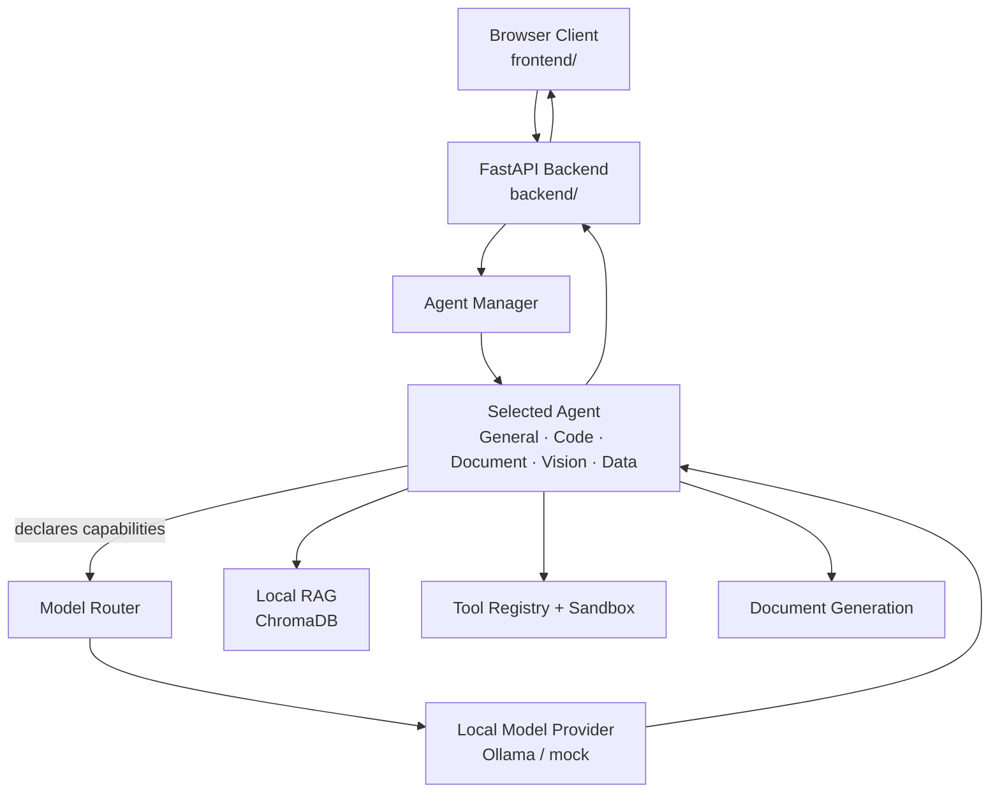

<div align="center">


</div>

## 📌 Overview

Cloud AI assistants can't be used in environments like refineries, PSUs, defence-linked manufacturing units, and government organizations where data can never leave the organization's own infrastructure. Sovereign AI Workbench gives these teams the same day-to-day usefulness — chat, document drafting, code help, image and data analysis — running entirely on hardware the organization controls, with no external AI API calls in its final deployment. It routes every request through a capability-scoring Model Router to one of five task-oriented agents, backed by local inference, local RAG and real document generation.

## ✨ Features

- 🧠 Five task-oriented agents (General, Code, Document, Vision, Data), each declaring required capabilities — never a model name
- 🎯 A Model Router that scores every registered, available model against an agent's required capabilities and picks the best fit
- 🔀 An independent Task Router for Auto mode that decides which agent handles a request
- 🦙 Local inference via Ollama over plain HTTP — no cloud SDK, no external API calls
- 📚 Local RAG (ChromaDB + local embeddings) with document ingestion and citations
- 🔎 Tesseract-backed OCR, honest about what's not wired up yet
- 🧰 Seven local tools behind a Tool Registry, plus sandboxed Python execution with a bounded generate → run → verify → revise loop
- 📄 Real deliverable generation — DOCX, XLSX, PDF and Markdown — handed back through the browser client

## 🛠️ Tech Stack

**Frontend**


**Backend**


**Tools**


**Also using**

  

## 🏗️ Architecture



## 📂 Project Structure

```
sovereign-ai-workbench/
├── frontend/              # React + Vite + TypeScript + Tailwind client
├── backend/
│   ├── app/
│   │   ├── agents/        # General, Code, Document, Vision, Data
│   │   ├── models/        # Model registry + router
│   │   ├── rag/           # ChromaDB-backed retrieval
│   │   ├── tools/         # File/document/data operations
│   │   ├── sandbox/       # Isolated code execution
│   │   └── security/      # Network monitoring, audit logging
│   └── requirements.txt
├── models/                # Local model docs/config — weights never committed
├── docs/                  # Architecture and deployment documentation
├── scripts/
└── docker-compose.yml
```

## ⚙️ Installation

```bash
git clone https://github.com/Fayaz-2007/workbench.git
cd workbench
```

**Frontend**

```bash
cd frontend
npm install
npm run dev
```

Visit `http://localhost:5173/` (User Workbench) and `http://localhost:5173/admin` (Admin Dashboard).

**Backend**

```bash
cd backend
python -m venv .venv
.venv\Scripts\activate        # Windows
pip install -r requirements.txt
copy .env.example .env
python -m uvicorn app.main:app --reload --host 0.0.0.0 --port 8000
```

Runs fully offline against the mock provider by default. For real local inference and RAG, install Ollama, pull `qwen2.5:1.5b-instruct` and `nomic-embed-text`, and set `MODEL_PROVIDER=ollama` / `EMBEDDING_PROVIDER=ollama` in `.env`.

### Environment variables

| Variable | Description |
|---|---|
| `MODEL_PROVIDER` | `mock` (default, offline) or `ollama` for real local inference |
| `EMBEDDING_PROVIDER` | Embedding backend for RAG, e.g. `ollama` |
| `VITE_API_BASE_URL` | Frontend's base URL for the backend API (e.g. `http://SERVER-IP:8000`) |
| `CORS_ORIGINS` | Allowed frontend origin(s) — never `*` |

## 🚀 Usage

1. Start the backend and frontend as above.
2. Pick an agent (General, Code, Document, Vision or Data) or let Auto mode's Task Router choose one.
3. Chat, upload a document for RAG-backed Q&A, or ask for a generated deliverable.
4. The Model Router picks the best available local model for that agent's declared capabilities.
5. Download the generated DOCX/XLSX/PDF/Markdown deliverable from the browser client.

`[Screenshot: User Workbench chat interface]`

`[Screenshot: Admin Dashboard]`

## 🔮 Future Improvements

- Wire up a real local vision model for the Vision Agent (currently mock)
- Real authentication, in place of the current structural foundation
- Container-backed sandbox for stronger code-execution isolation
- Real network/system/audit telemetry on the Admin pages (currently frontend mock data)

## 👨‍💻 Author

**Fayaz Ahmed**
GitHub: [@Fayaz-2007](https://github.com/Fayaz-2007)
LinkedIn: [fayaz-ahmed-59287631a](https://linkedin.com/in/fayaz-ahmed-59287631a)

<div align="center">


</div>
